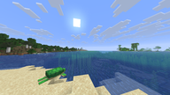
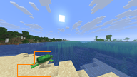

変化位置の説明と結合枠の比較 — 2026-10-29

**今回の8組では、枠なしの位置説明を優先する理由があります。カメは位置説明で3/3認識でき、結合枠では0/3でした。明るさ判定文を共通で添えた今回の条件では、明るくなった床の返答は両条件とも3/3で正しい向きでした。**

コードの変化判定・閾値・検出マスは前回から固定しています。変更していない検出器のhash、同じ設定、全48マスの再計測値を照合して一致を確認しました。変化ありの8組×2条件×3seed（42/43/44）、計48応答を同じGemma 4で取得しました。

両条件へ同じ明るさ判定文を渡します。画像の一部だけの変化として「明るくなった領域を検出した」「暗くなった領域を検出した」「両方の領域を検出した」「変化は検出していない」を区別しました。強度・変化率・検出個数はモデルへ渡しません。

位置説明は、枠のない画像に「左側、下部」などの範囲と、8×6内の具体的な行列を添えます。結合枠は、接するマスの共有辺を消して外周だけを表示し、その旨を添えます。物体名や日の出などの正解ラベルは入力していません。

| 確認項目 | 枠なし＋位置説明 | 結合した外周枠 |
|---|---|---|
| 全体の発話 | 23/24 | 24/24 |
| カメの特定 | 3/3 | 0/3 |
| 明るくなった床 | 3/3で明るくなった | 3/3で明るくなった |
| 夜明け | 日の出／明るさが2件、沈黙1件 | 日の出／明るさが3件 |
| 注釈枠そのものへの発話 | 0件 | 0件 |

発話の有無と内容の正しさは別に確認しています。夜明けで沈黙した1件を認識誤りとは数えていません。

カメの前後比較に渡した後画像です。左が位置説明条件の画像、右が結合枠条件の画像。

| 位置説明条件 | 結合枠条件 |
|---|---|
|  |  |

位置説明条件の返答例：「あ、見て！カメさんが歩いてきたで！」。結合枠条件：「あ、砂浜に緑色の塊が落ちてるで！何やろな？」。特定の対象を指す位置の説明だけでカメを見分けられ、枠を結合してもこの画像の特定は改善しませんでした。

| ケース | 場面 | 枠なしの発話 | 結合枠の発話 | 内容確認 |
|---|---|---:|---:|---|
| [pair_06 前](pair_06/before-model.png)・[枠なし](pair_06/after-model.png)・[結合枠](pair_06/after-merged.png) | 砂浜にカメが出現 | 3/3 | 3/3 | 位置説明は3/3でカメを特定。結合枠は3/3で「緑色の何か／塊」と表現し、カメを特定しなかった。 |
| [pair_07 前](pair_07/before-model.png)・[枠なし](pair_07/after-model.png)・[結合枠](pair_07/after-merged.png) | 金鉱石の壁の右上が明るくなる | 3/3 | 3/3 | 位置説明は3/3で右上の明るさに言及。結合枠は3/3で金の発見に言及。画像の変化を話すか、見えている物を話すかが異なる。 |
| [pair_08 前](pair_08/before-model.png)・[枠なし](pair_08/after-model.png)・[結合枠](pair_08/after-merged.png) | 洞窟内の松明周辺などが変わる | 3/3 | 3/3 | 明るさは閾値未満と共通通知。位置説明は3/3で「急に暗くなった」。結合枠は3/3で松明に言及するが、1件は「落ちたっぽい」と補作し暗くなったとも述べた。 |
| [pair_09 前](pair_09/before-model.png)・[枠なし](pair_09/after-model.png)・[結合枠](pair_09/after-merged.png) | 海岸の夜明け | 2/3 | 3/3 | 位置説明は1件沈黙、1件日の出、1件明るくなった。結合枠は3件とも日の出または明るくなった。夕焼けとの誤読は今回は0件。 |
| [pair_10 前](pair_10/before-model.png)・[枠なし](pair_10/after-model.png)・[結合枠](pair_10/after-merged.png) | 右側の地形が新たに表示される | 3/3 | 3/3 | 両条件とも3/3で景色・地形の変化に言及。位置説明の1件は木が増えたと表現。実世界での成長までは画像から確定していない。 |
| [pair_11 前](pair_11/before-model.png)・[枠なし](pair_11/after-model.png)・[結合枠](pair_11/after-merged.png) | 水中洞窟の床が明るくなる | 3/3 | 3/3 | 両条件の全6件が明るくなったと回答。暗くなったとの逆向き比較と、オレンジ枠自体への言及は今回はなし。 |
| [pair_12 前](pair_12/before-model.png)・[枠なし](pair_12/after-model.png)・[結合枠](pair_12/after-merged.png) | 暗い水中で大きく視点が変わる | 3/3 | 3/3 | 検出は上部1マスの明るさ差。両条件とも3/3で明るくなったと回答。局所差から視界全体が急に明るくなったように述べる例は残る。 |
| [pair_13 前](pair_13/before-model.png)・[枠なし](pair_13/after-model.png)・[結合枠](pair_13/after-merged.png) | 水中から夜の砂浜へ移動・旋回する | 3/3 | 3/3 | 位置説明は3/3で陸・地上へ出たこと、結合枠は3/3で視界・景色の変化に言及。前回の太陽が出たかという推測や、一方向に明るくなったとの返答は今回はなし。 |

前回は明るくなった床を暗くなったと述べたり、枠そのものを話題にしたりする返答がありました。今回は床で全6件が明るくなったと回答し、夜明けの夕焼け誤読もありません。ただし明るさ判定文の追加と提示方法の変更を同時に行っているため、前回との差をどちらか一方の効果と断定しません。

残る問題は、明るさが閾値未満の松明の画像でも「急に暗くなった」と述べる点と、暗い視点変更の上部1マスの明るさ差を視界全体の変化のように大きく表現する点です。判定結果を渡しても、モデルの誇張や補作を完全には抑えていません。

**この比較での採用候補は、変化ありを検出したら枠を付けず、具体的な位置と明るさ判定文を添える方式です。** 結合枠は広い場面で内部線を減らせますが、カメの特定では改善が得られませんでした。この8組の試験結果であり、別の撮影列や実運用の連続会話は未評価です。

48応答すべて正常終了し、内容を解釈できました。42件が生JSON、6件がコード枠付きJSONです。終了コード2は取得後の内容確認待ちで、この文書が確認結果です。再試行・追加採点モデルは使用していません。

検証では検出器・全マス判定の不変、位置文を行列へ戻した検出集合の一致、共有辺が消えて外周だけ描かれること、枠以外の画素の保持、明るさ判定文と共通条件の一致を確認しました。独立の読み取りレビューでも重大な不備は見つかりませんでした。

[全48応答](REPORT.md)・[生の要求と応答](results.jsonl)・[判定と位置説明](manifest.json)・[要求プレビュー](request-previews.json)・[内容確認記録](review.json)

[位置説明・枠結合のコード](../../combined/dogido-rust/tests/acceptance/part5_grid_presentation.py)・[詳細な試験手順](../../combined/dogido-rust/tests/acceptance/part5_grid_presentation.md)
