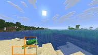

8×6マスの変化枠・無変化通知の実モデル比較 — 2026-10-29

**「変化がない」は、無検出5組の15応答すべてで沈黙につながりました。一方、枠付き条件ではカメの特定や明るさの解釈が悪化する例があり、枠表示の品質には課題が残ります。**

同じ実撮影13組×2条件×3seed（42/43/44）、計78応答。稼働中のGemma 4 26B A4B QAT UD Q4_K_XL＋F16 projectorを使用しました。前後2枚の192px画像・共通指示・時刻・カメラ移動量は共通です。差分の率・検出マス数・閾値はモデルへ渡していません。

| 対象 | 画像だけの発話 | 枠／無変化通知の発話 |
|---|---:|---:|
| 全13組 | 33/39 | 24/39 |
| 無検出の5組 | 10/15 | 0/15 |
| 検出ありの8組 | 23/24 | 24/24 |

対照の39応答は前回の「画像だけ」条件と全件同じ本文でした。発話をそのまま誤反応とは数えません。コードが無検出とした5組には微小な動きもあり、世界に一切変化がないことを証明する試験ではありません。

横8×縦6の各マスを8×8小区画で計測しました。一様なRGB差を除いた局所残差の上位4点平均が60以上、差45以上の点が3点以上つながる場合を局所変化とします。明るさは別判定で、符号付き輝度差の中央値が絶対値18以上、同じ方向の差12以上が64点中40点以上の場合です。単位はいずれも0〜255の強度です。

検出マスだけ後画像へ1pxのオレンジ枠を加え、「変化領域をオレンジ色の枠で表示しています。」を添えます。未検出なら画像を変えず「変化がない」を添えます。閾値は実モデルの返答を見る前に固定しましたが、同じ13組で校正した値なので未知の場面への有効性までは確認していません。

| ケース | 検出マス | 画像だけ | 枠／通知 | 実画像と結果 |
|---|---:|---:|---:|---|
| [pair_01 前](pair_01/before-model.png)・[後](pair_01/after-grid.png) | 0 | 3/3 | 0/3 | 完全同一の金鉱石画像。「変化がない」で3回とも沈黙。対照は3回とも金鉱石への発話。 |
| [pair_02 前](pair_02/before-model.png)・[後](pair_02/after-grid.png) | 0 | 1/3 | 0/3 | 海岸の小さな明るさ・雲の差。閾値未満として通知し、3回とも沈黙。対照は1回だけ景色への感想。 |
| [pair_03 前](pair_03/before-model.png)・[後](pair_03/after-grid.png) | 0 | 0/3 | 0/3 | 水中の微細差。両条件とも3回沈黙。 |
| [pair_04 前](pair_04/before-model.png)・[後](pair_04/after-grid.png) | 0 | 3/3 | 0/3 | 水中の泡・描画の小さな差。「変化がない」で3回沈黙。対照は3回景色への感想。 |
| [pair_05 前](pair_05/before-model.png)・[後](pair_05/after-grid.png) | 0 | 3/3 | 0/3 | 水中の人物の向き・小さな色の差。今回の閾値では無検出。3回沈黙。対象の小さな動きを全て拾う設定ではない。 |
| [pair_06 前](pair_06/before-model.png)・[後](pair_06/after-grid.png) | 3 | 3/3 | 3/3 | 砂浜にカメが現れる。3マスで局所差を検出。枠条件は3回とも緑色の何かと表現し、カメの特定は0/3。対照は3/3でカメを特定。 |
| [pair_07 前](pair_07/before-model.png)・[後](pair_07/after-grid.png) | 1 | 3/3 | 3/3 | 金鉱石壁の右上の見え方が変わる。右上の明るさ差1マスを検出。両条件とも金に関する発話。新発見や採掘の実イベントまでは画像から確定できない。 |
| [pair_08 前](pair_08/before-model.png)・[後](pair_08/after-grid.png) | 1 | 3/3 | 3/3 | 洞窟。人物が上端へ動き、左側の松明周辺も変わる。検出したのは左の松明周辺1マス。枠条件の全3応答が松明に言及し、人物の動きには言及しない。1件は壁の松明を「落ちてる」と表現。 |
| [pair_09 前](pair_09/before-model.png)・[後](pair_09/after-grid.png) | 22 | 3/3 | 3/3 | 海岸の夜明け。空を中心に22マスで明るさ変化を検出。枠条件は日の出を述べた1件、夕焼けと誤読した1件、景色の感想1件。 |
| [pair_10 前](pair_10/before-model.png)・[後](pair_10/after-grid.png) | 13 | 3/3 | 3/3 | 右側の地形が表示される。13マスを検出。枠条件は2件が雲の形、1件が明るさの変化に言及し、目立つ地形表示への言及はない。 |
| [pair_11 前](pair_11/before-model.png)・[後](pair_11/after-grid.png) | 20 | 2/3 | 3/3 | 水中洞窟の床が明るくなる。床を中心に20マスを検出。枠条件は暗さ、地面の変化、オレンジ色の枠そのものへの発話が各1件。明るさの向きの理解は安定しない。 |
| [pair_12 前](pair_12/before-model.png)・[後](pair_12/after-grid.png) | 1 | 3/3 | 3/3 | 暗い水中での大きな視点変更。上部1マスで明るさ変化を検出。枠条件は明るくなったが2件、目の前の何かが1件。元画像全体では広い見え方の変化があり、1マスの枠で全変化を説明できない。 |
| [pair_13 前](pair_13/before-model.png)・[後](pair_13/after-grid.png) | 44 | 3/3 | 3/3 | 水中から夜の砂浜へ移動・旋回。44マスを検出。枠条件の全3件が明るくなったと表現し、1件は太陽が出たかと推測。枠自体が暗い画像を明るくする交絡がある。 |

代表例です。

- **完全同一画像**：画像だけでは「お、金が見つかったで！」。無変化通知では3回すべて沈黙。小さな揺れの4組も含め、通知条件は15/15で沈黙でした。
- **カメ**：検出自体は成功し3マスに枠が付きます。しかし画像だけなら3/3でカメと特定したのに対し、枠条件は「あ、砂浜に何か緑色のん落ちてるで！何やろな？」など、全3件が緑色の何かという回答になりました。
- **夜明け**：小さな明るさ変動の海岸画像は無検出、夜明けは22マスで検出できました。返答は「太陽が昇ってきたな」が1件、「綺麗な夕焼け」が1件、通常の景色の感想が1件で、出来事の解釈は安定していません。
- **明るくなった床**：「地面のところにオレンジ色の枠みたいなのが出てるで？」という回答があり、注釈そのものを話題にしています。
- **夜の砂浜**：後画像の平均輝度は枠なし35.920→枠付き54.892。広い範囲に明るい線を描くため、注釈が画像自体の明るさを変えています。全3応答が明るくなったと答えましたが、因果を枠だけに特定する比較はしていません。

カメの実際のモデル入力（後画像）です。

**判断**：「変化がない」という通知の効果は今回の条件では明瞭でした。枠表示は、検出した場所に注意を向ける一方、対象を見分けにくくしたり、注釈自体を景色として扱わせたりする結果もあります。現行の192px・1px枠をそのまま品質改善とみなすことはできません。枠と説明の単独効果、別の枠表現、別解像度は今回未測定です。

78件とも正常終了し、内容を解釈できました。77件が生JSON、1件がコード枠付きJSONです。送信中の再試行や別LLMによる採点はしていません。終了コード2は取得後の内容確認待ちで、この文書が内容確認結果です。

検証では52個の元画像hash、未検出画像のバイト同一性、変更画素が検出マスの枠上だけであること、対照条件との差が後画像と指定文言だけであることを確認しました。独立の読み取りレビューでも同じ条件を確認しています。

[全78返答](REPORT.md)・[生の要求と応答](results.jsonl)・[閾値とマス別判定](manifest.json)・[要求プレビュー](request-previews.json)・[内容確認記録](review.json)

[検出と枠のコード](../../combined/dogido-rust/tests/acceptance/part5_grid.py)・[試験の実行コード](../../combined/dogido-rust/tests/acceptance/part5_model.py)・[詳細な実行手順](../../combined/dogido-rust/tests/acceptance/part5_grid.md)
